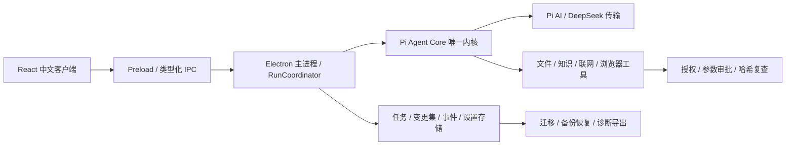

# 开发者智能体工作台 · Agent Workbench

单用户、本地优先的中文 Windows 桌面 Agent，用于理解代码仓库、结合资料调研，以及在逐次授权后修改代码。

重点是**可续接的任务执行、带来源的检索、可审查的代码变更和桌面数据管理**。当前为作品开发版，复用 Pi Agent Core 作为唯一 Agent 内核；应用层实现权限、预算、任务状态、检索、审批与客户端。

[下载](#download) · [功能状态](#capabilities) · [技术架构](#architecture) · [源码启动](#source) · [更新记录](CHANGELOG.md)

<a id="download"></a>
## 下载与首次使用

当前 Windows x64 版本为 **0.2.0 预览版**。现有安装包于 2026-10-12 完成编译与打包，已记录独立部署和主窗口启动；安装器安装流程、完整功能与真实模型调用仍待验收。

打开 [Releases](https://github.com/jtjjyy/agent-workbench/releases)，选择 `0.2.0` 预发布条目中的安装包或便携 ZIP。发布条目尚未出现时请使用下方源码入口。安装包未签名，仅用于作品体验；不要将它视为经过完整验证的正式版本。

1. 安装或解压后运行 `agent-workbench.exe`。
2. 在首次配置和“模型设置”中配置自己的新 API 密钥，并确认数据外发范围。
3. 选择工作区，授权范围和外发分别确认，再提交代码理解或资料调研任务。
4. 模型提出代码修改时查看完整 Diff，批准当前具体变更后才写入。

仓库和安装包不提供密钥。保存配置不会自动发起真实模型请求。没有真实模型配置时可用本地模拟模式，它不执行真实仓库工具。

<a id="capabilities"></a>
## 功能状态

| 能力 | 当前实现 | 重要边界 |
| --- | --- | --- |
| 模型与 Agent | DeepSeek、流式回复、Pi 工具循环、结构化参数、取消与超时 | 本轮没有真实模型或回归测试证据 |
| 持续任务 | 计划与状态持久化、暂停、取消、人工续接、中断识别 | 恢复不盲目重放有副作用调用 |
| 代码交付 | 多文件提案、完整 Diff、逐次审批、内容哈希复查、交付查询 | 当前验证开关关闭，代码交付保持“未验证” |
| 知识与记忆 | 项目摘要、关键词检索、增量索引、路径/行号/哈希来源、可管理记忆 | 当前不是向量检索；本地数据可能为明文 |
| Skills | 内置与本地 `SKILL.md`、关键词匹配、启用管理 | Skills 不增加工具权限 |
| 联网与浏览器 | 网页搜索、网页读取、打开页面、读取、截图、点击和输入 | 外部内容不可信；交互需具体审批 |
| 命令执行 | PowerShell 执行器、审批、预算、超时与取消代码 | 当前 `run_powershell` 整体停用，防止绕过暂停验证策略 |
| 桌面交付 | 固定数据目录、旧数据迁移、首次配置、备份恢复、诊断导出、明确启动入口 | 不保证跨账号密钥恢复或断电级原子性 |
| 事件与成本 | 任务和工具轨迹、状态事件、服务端用量记录 | 缺少用量时显示未知；尚无质量/成本对比报告 |
| MCP / 多 Agent | 尚未接入 | 后续按实际任务价值推进 |

这些条目表示源码接入状态，不代表全部已通过运行验收。暂停验证期间 `run_verification` 不运行，模型、Skills 或工具参数不能自行开启；代码修改不能凭“写入成功”直接宣称任务交付完成。

<a id="architecture"></a>
## 技术架构



| 层 | 技术与入口 |
| --- | --- |
| 语言与桌面 | TypeScript、Node.js、Electron 44.7.0、Electron Forge 8.0.1、Webpack |
| 客户端 | React 18.3.1、Lucide、主进程与渲染进程隔离 |
| Agent 与模型 | `@earendil-works/pi-agent-core@1.1.0`、`@earendil-works/pi-ai@1.1.0`、TypeBox |
| 应用执行 | `src/main/agent/`、`src/main/tasks/`、`src/main/changes/`、`src/main/tools/` |
| 知识与 Skills | `src/main/knowledge/`、`src/main/skills/`，本地文件索引与 JSON 持久化 |
| 数据与交付 | JSON/JSONL、Electron safeStorage、SHA-256、jsdiff、`src/main/desktop/` |
| 质量工具 | Vitest、Testing Library、Playwright、ESLint；本轮暂停执行 |

精确依赖见 `package-lock.json`。项目是模块化单体，不包含多租户、计费、插件市场或分布式服务。

<a id="source"></a>
## 从源码启动

需要 Windows、Node.js `>=24.15.0` 和 npm。

```powershell
git clone https://github.com/jtjjyy/agent-workbench.git
cd agent-workbench
npm ci
npm start
```

`npm start` 会执行正常开发编译及构建链中的自动类型检查。现有桌面产物可以直接打开；本次发布没有重新编译、测试、Lint、独立类型检查或真实模型调用。

打包及部署入口见 [桌面交付说明](docs/desktop-delivery.md)。安装包是先前构建结果；便携 ZIP 仅对相同程序文件重新压缩。此次没有重新编译程序，下载文件的哈希以发布页的校验附件为准。

## 权限、数据与开源边界

- 选择目录不等于同意仓库内容外发；模型请求由主进程向配置端点发送。搜索服务、网页访问也会暴露查询或访问元数据。
- 文件工具限制工作区、类型和内容大小，拒绝越界与部分敏感路径。审批绑定具体参数与哈希，并在写入前复查；这些属于应用策略，不是操作系统沙箱。
- 渲染进程启用上下文隔离与沙箱，但不能据此声称主进程命令工具也被隔离。
- 模型密钥通过系统安全存储保存；会话、来源片段、任务与记忆可能为本地明文。日志导出与备份需自行审查内容。
- 不自动丢弃用户已有代码变更，不保证任意操作回滚、同权限恶意进程隔离、跨机密钥恢复或断电级恢复。

应用项目代码采用 [MIT](LICENSE)。Pi、Electron、模板与依赖的复用范围见 [第三方声明](THIRD_PARTY_NOTICES.md)。开发者与 AI 编程工具协作实现应用层，不声称从零实现模型或 Pi 内核。

## 学习与交付文档

- [设计方案](outputs/agent-workbench-design.md)与 [可靠交付映射](docs/learning/reliable-delivery.md)。
- [任务恢复](docs/learning/task-recovery.md)、[代码变更闭环](docs/learning/change-set-delivery.md)、[桌面交付](docs/desktop-delivery.md)。
- [记忆与知识库](docs/learning/stage5-memory-knowledge.md)、[Skills](docs/learning/stage9-skills.md)、[工具能力](docs/learning/stage10-tools.md)。
- [本次发布记录](docs/publication.md)与 [历史阶段说明](docs/history/stage-notes.md)。

早期 `outputs/stage1-evidence/` 仅证明当时的模拟版本，不代表新增模型、工具、修改和恢复能力已验证。简历与演示材料应以源码和实际证据说明个人贡献，不使用未经测量的性能、用户量或商业收益。
