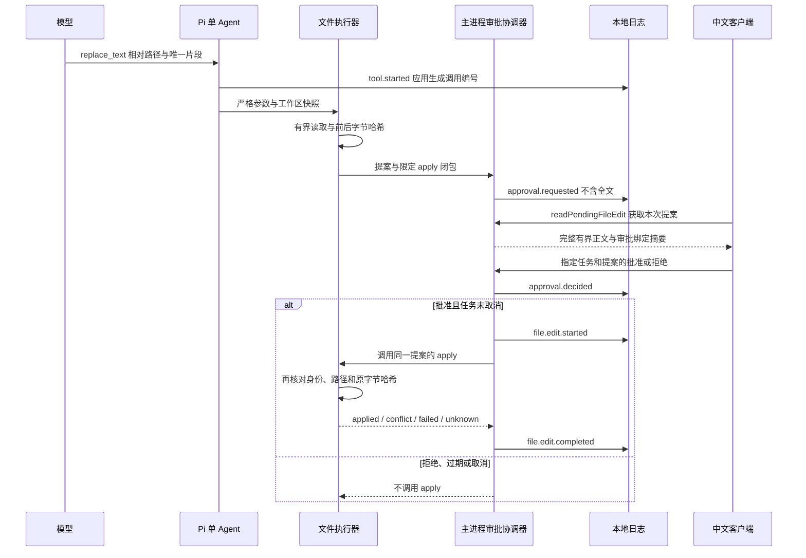

# 第四阶段：审批状态与可解释执行

日期：2026-10-10。状态：源码与测试用例编写阶段，未运行验证。

## 复用和自研边界

继续只复用一套 Pi 工具循环。差异算法复用 `diff@9.0.0`；审批协议、任务接线、
文件策略和中文展示由本项目代码实现，使用主 Agent 与两个并行开发子 Agent 协助。
这些子 Agent 不代表产品已经实现多 Agent 协作。个人简历贡献按实际学习和排障记录描述。

## 纵向数据流

日志写入成功回执不是 fsync 事务；`decideFileEdit` 的成功仅代表接收并消费决定，
不是文件写入完成。只有实际完成事件支持相应的执行结果展示。

## 主线映射

| 知识点 | 产品需求 | 实现模块 | 待执行测试证据 | 面试问题 / 亲自练习 |
| --- | --- | --- | --- | --- |
| 一次性权限 | 不能批准一个操作却写另一个文件 | `file-edit.ts`、`file-edit-approvals.ts` | 伪造 runId/digest、重复批准、重启旧批准 | 为什么只传“同意”两个字不够？亲自改动摘要看拒绝分支 |
| TOCTOU 与快照 | 审批期间不覆盖新编辑 | 文件工具与 SHA-256 复核 | 等待审批时改文件，观察 conflict | 为什么哈希复查仍不等于跨进程事务？ |
| 异步状态机 | 取消、过期、日志失败不得意外放行 | `FileEditApprovals`、`RunCoordinator` | 拒绝/取消/60秒过期/开始日志失败 | 解释 consumed 为何在 await 之前设置 |
| 副作用跟踪 | 任务失败不代表文件未改 | 4类审批与写入事件、结果未知中止 | 写入成功后取消、完成日志失败、进程中断 | 亲自画出“已写入但未记录完成”的时序 |
| IPC 最小权限 | UI 不直接传任意路径与正文写盘 | handlers、preload、AgentBridge | 多余字段、不同来源frame、旧审批 | 为什么主进程要重新校验，不能只禁用按钮？ |
| 不可信展示 | 代码文本不能成为脚本 | FileEditReview + jsdiff | 脚本原文、长行、换行与BOM | 修改一个包含 `<script>` 的实验文件解释渲染方式 |
| 可证实的结果 | 不把提示词当执行安全保证 | Pi fail机制、文件完成事件 | unknown阻止后续执行、工具错参 | 为什么提示词中说“不能写”不是权限控制？ |

以上均为待执行证据，不是通过记录。`tests/unit/file-edit-approvals.test.ts` 只写入用例，
没有运行红绿测试循环；不把未执行测试命名或数量当作覆盖率。

## 独立实验

恢复验证后只在有备份的实验仓库做：批准前并发修改、批准后取消、写入完成但日志失败、
中断后打开日志辨认结果未知。分别记录原始模型版本、Pi版本、提示词、设置、日志与文件快照。
不在真实个人仓库通过破坏操作演示可靠性，不寻找、发送或保存已有秘密。

## 原理学习

- 乐观并发检查、文件身份与哈希分别证明什么；硬链接与符号链接的差别。
- 状态日志、真正的 WAL/fsync 与文件系统事务的边界。
- 操作取消是停止后续工作的请求，不是对已经发生副作用的补偿事务。
- 审批绑定摘要不是身份认证签名；安全还依赖可信 IPC 和主进程限定执行闭包。

## 固定回归与求职证据

开发集至少覆盖唯一匹配、拒绝、审批中冲突、过期、取消、写入未知；保留集使用不同路径、
不同代码内容、链接与中断位置，不能拿调过提示词的开发任务当泛化成功率。
Mock、工具单元、真实模型、桌面端到端分开统计。当前用户暂停验证，
没有新增成功率、时间、成本、性能提升或生产使用记录可写入简历。
