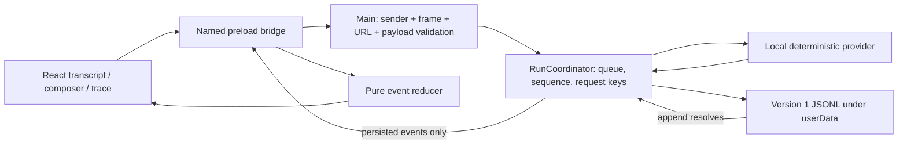

# Stage 1 Engineering Notes

Date: 2026-10-10. Scope: the approved Stage 0-1 deterministic desktop slice.
Verification owner: assistant/controller and development subagents, not the learner.

## Actual Architecture

There is one process owner for journal writes. The renderer never receives a
filesystem API, arbitrary IPC channel, command executor or model credential.
Subscription starts before history read; overlapping buffered events are merged
by sequence. Event types and runtime validators share a module; static types
alone do not authorize IPC input.

No Pi dependency or second Agent kernel is introduced. `AgentProvider` is an
application boundary around a fixed local test double, not a new LLM framework.
Actual provider selection and tool-loop reuse are deferred to the next stage.

## Decisions And Deviations

| Decision | Evidence / reason | Limit |
| --- | --- | --- |
| Official Forge 8 Webpack/TypeScript template | Old `webpack-typescript` initializer rejected; supported CLI uses `--template webpack --typescript` | `.mts` config and `.cjs` output differ from illustrative plan names |
| React 18.3.1 and template TypeScript 6.0.3 | Installed lockfile and successful checks/build | Not a claim of newest versions |
| JSONL event journal for one conversation | Real filesystem tests and packaged restart E2E | No fsync, migration, backup, external-writer protection or large-history benchmark |
| Persist before notification | Coordinator waits for append before subscriber delivery | Renderer-observed disk reads alone do not prove all timing interleavings |
| Fail closed on write failure | No unpersisted event is broadcast; runtime stops accepting submissions | Reopen after resolving storage problems; no automatic disk repair |
| Inspector fuse enabled | Required by this stage's packaged Playwright harness | This package is not a hardened production release |
| Inline-style CSP exception | Template style-loader injects styles | Inline script and eval remain disallowed |
| Parallel development, not product multi-agent | Bounded journal/UI/E2E/review tasks | No agent-collaboration product efficacy claimed |

## Fault Investigations

### Packaged IPC Rejected The Real Window

The first packaged E2E run launched the real executable, but all three cases
failed while the UI displayed `Unavailable`. Main reported `Untrusted IPC sender`.
The bundle contained Forge's raw `file://D:\...Agent Workbench...` string; Chromium
reported `file:///D:/...Agent%20Workbench...`. Comparing the two strings rejected
legitimate commands. A focused integration regression failed before the fix,
then passed when expected URLs were canonicalized.

Independent review identified a related case: canonicalizing an already
unescaped URL does not preserve literal `#` or percent-encoded-looking filename
characters. The final implementation constructs the packaged URL from the
absolute filesystem path and uses that same URL for loading and authorization.
Exact window/frame identity and exact URL comparison remain in place.
The final package also passed a real launch, prompt and orderly exit from a
directory containing spaces, `#` and literal `%20`.

### Malformed Journal Tail Could Be Truncated

Parser EOF diagnostics alone were too permissive. An unfinished string with a
raw tab, or a partial Unicode escape with a trailing space, could be classified
as interrupted JSON and removed by the next append. The fix checks the original
EOF position plus string escape/control-character validity before permitting
truncation. Tests assert that corruption bytes remain unchanged on read/append
failure, and exercise every byte prefix of a representative valid record.

The new regression first produced 10 failures with 70 passes; after correction,
all 80 event-store tests passed. The exhaustive prefix test exceeded its original
5-second timeout when run alongside compilation. Only that IO-heavy test has a
30-second limit; no corruption assertion is skipped.

### Test Harness Cleanup Handle

The E2E originally requested `app.process()` after `app.close()`, when Playwright's
remote handle had already been disposed. Capturing the child process before
closing fixes the harness without relaxing its zero-exit or profile-safety
checks. This was a test harness defect, distinct from the real IPC defect.

### Independent Review Of Failure Status And Assertions

Review found two further gaps: a journal failure could leave transient UI status
claiming `Running`, and assertions inside subscriber callbacks could be swallowed
by intentional subscriber exception isolation. Both were corrected and
independently re-reviewed. A narrow `SubmitMessageResult` returns
`{ status: 'unavailable', code: 'JOURNAL_WRITE_FAILED' }` for storage failure,
while successful submission still resolves without a value. This intentionally
extends the plan's `Promise<void>` response without adding a new IPC command or
journal event. The UI preserves the transcript/draft and shows stopped/unavailable
state with restart guidance. It does not fabricate persisted events or promise
disk repair.

Timing tests now record all callback observations and assert them outside the
subscriber. Both success and failure paths gate every append, including deltas
and terminal events. A temporary early-delta-broadcast mutation made both tests
fail; the mutation was removed before the final passing run.

## Security And Delivery Scope

The sandbox is Electron's renderer sandbox, not containment for arbitrary main
process tools. Approval dialogs, shell isolation, workspace enforcement and
side-effect recovery are not implemented yet. The journal contains plaintext
prompts and responses. There are no API keys or model requests in this slice.

The development dependency audit reported 7 high and 2 moderate findings;
the production dependency audit reported zero. This does not audit Electron's
whole native dependency stack or establish absence of exploitable defects.
The development server binds only to loopback; it should not be exposed publicly.
Do not run a forceful audit downgrade without a separate compatibility review.

The installer is unsigned and installation/upgrade/uninstallation have not been
tested. Generating an EXE or ZIP is not installation evidence. Normal quit and
relaunch tests do not prove recovery from power loss, arbitrary process kill or
external journal mutation.

## Attribution

The controller integrated the scaffold/runtime, reproduced packaged failures and
ran the final matrix. Subagents implemented/reviewed the journal, renderer and
E2E harness with disjoint file ownership. Independent review drove additional
corrections. See `docs/learning/stage1-checkpoints.md` for the
knowledge -> requirement -> module -> test -> interview mapping.

The learner has not yet performed the listed exercises. A future resume must
distinguish assistant-assisted implementation, upstream reuse and personally
completed debugging/experiments. There is no user-count, revenue, production-use
or measured performance-improvement claim.
